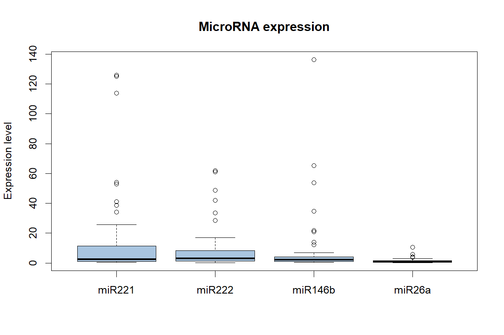
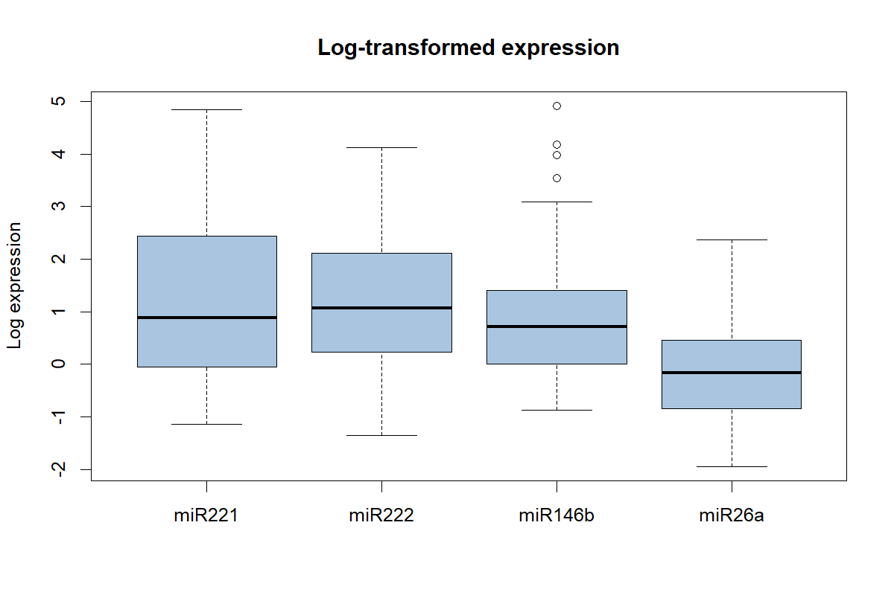
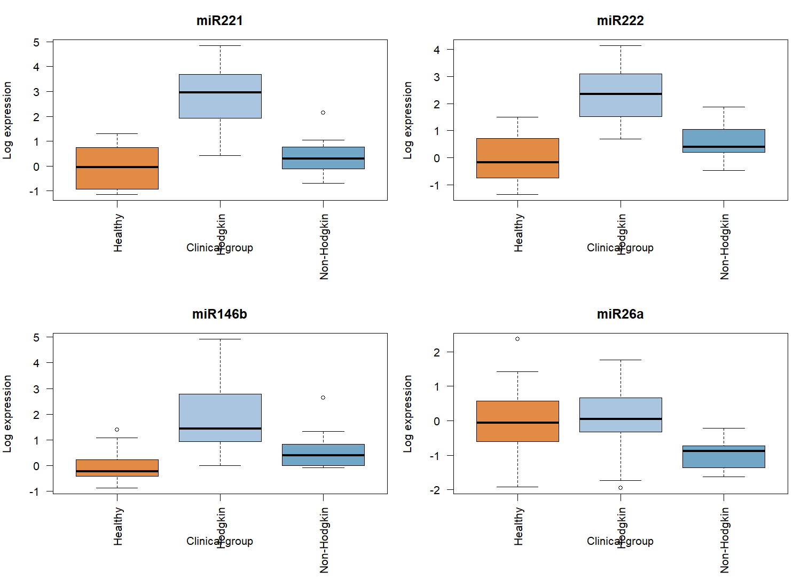
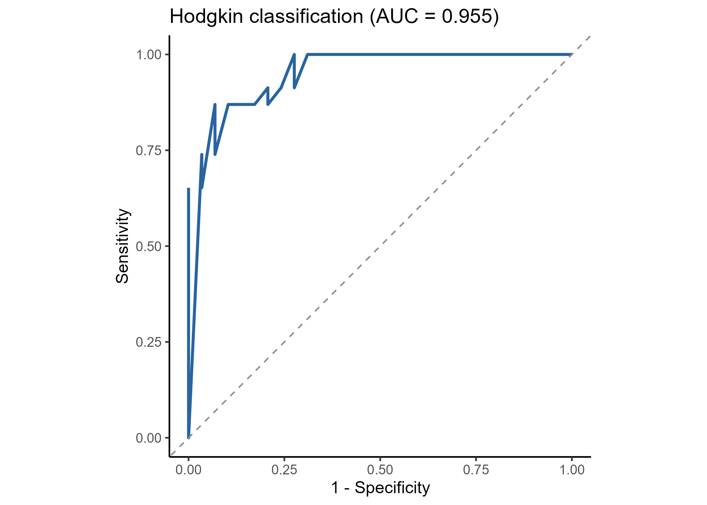

# MicroRNA-Based Classification of Hodgkin Lymphoma

## Project Overview

This project investigates the association between **microRNA expression profiles and lymphoma classification** using exploratory statistical analysis and binomial logistic regression in R.

The dataset contains expression measurements of four microRNAs (**miR221, miR222, miR146b, and miR26a**) from 52 subjects belonging to three clinical groups: healthy controls, Hodgkin lymphoma patients, and Non-Hodgkin lymphoma patients.

The primary objective is to identify microRNA markers associated with Hodgkin lymphoma and develop a parsimonious logistic regression model to distinguish Hodgkin lymphoma patients from healthy controls and Non-Hodgkin lymphoma patients.

## Dataset

The dataset contains **52 observations** and four microRNA expression variables.

### Sample Characteristics

| Clinical Group | Type | Subjects |
|---|---|---:|
| Healthy controls | 0 | 15 |
| Hodgkin lymphoma | 1 | 23 |
| Non-Hodgkin lymphoma | 2 | 14 |
| **Total** | | **52** |

### Variables

| Variable | Description |
|---|---|
| `Type` | Clinical classification (0 = Healthy, 1 = Hodgkin, 2 = Non-Hodgkin) |
| `miR221` | miR221 expression level |
| `miR222` | miR222 expression level |
| `miR146b` | miR146b expression level |
| `miR26a` | miR26a expression level |
| `case` | Binary response (1 = Hodgkin; 0 = Healthy or Non-Hodgkin) |

No missing values were detected in the dataset.

**Data Availability:** The original individual-level dataset is not publicly distributed with this repository. The statistical results and figures are provided below. The R script can be adapted to comparable datasets by modifying the data source, variable names, and group definitions.

## Statistical Methods

The analysis includes:

1. **Exploratory Data Analysis (EDA):** Descriptive statistics and boxplots of microRNA expression levels.
2. **Logarithmic Transformation:** Transformation of expression measurements to investigate skewness and facilitate comparisons.
3. **Normality Assessment:** Shapiro–Wilk tests and Q-Q plots.
4. **Correlation Analysis:** Spearman rank correlations among microRNA markers.
5. **Group Comparisons:** Kruskal–Wallis tests followed by pairwise Wilcoxon tests with Holm adjustment.
6. **Logistic Regression:** Binomial logistic regression initially including all four log-transformed microRNA markers.
7. **Variable Selection:** Backward selection using likelihood-ratio tests.
8. **Model Evaluation:** Odds ratios, confidence intervals, likelihood-ratio testing, confusion matrix, accuracy, sensitivity, specificity, and ROC analysis.

## Main Results

### 1. Exploratory Analysis

MicroRNA expression levels showed substantial variability and positively skewed distributions, with several extreme observations.

Logarithmic transformation reduced the influence of extreme values and improved visualization of the expression distributions.





### 2. Correlation Analysis

Spearman correlation analysis identified positive associations among the four microRNA markers.

| MicroRNA Pair | Spearman ρ |
|---|---:|
| miR221 – miR222 | 0.972 |
| miR221 – miR146b | 0.842 |
| miR222 – miR146b | 0.806 |
| miR221 – miR26a | 0.548 |
| miR222 – miR26a | 0.543 |
| miR146b – miR26a | 0.319 |

The strongest correlation was observed between **miR221 and miR222** (ρ = 0.972), suggesting substantial overlap in their expression patterns.

### 3. Group Comparisons

Kruskal–Wallis tests identified statistically significant differences among the three clinical groups for all four microRNAs.

| MicroRNA | Kruskal–Wallis χ² | p-value |
|---|---:|---:|
| miR221 | 31.192 | 1.69 × 10⁻⁷ |
| miR222 | 32.070 | 1.09 × 10⁻⁷ |
| miR146b | 24.713 | 4.30 × 10⁻⁶ |
| miR26a | 14.299 | 0.000785 |

Pairwise Wilcoxon comparisons with Holm correction revealed differences in expression patterns across clinical groups.

In particular, miR221 and miR222 differed significantly between Hodgkin lymphoma patients and both healthy controls and Non-Hodgkin lymphoma patients. No statistically significant differences were observed between healthy controls and Non-Hodgkin lymphoma patients for these two markers.



### 4. Logistic Regression

An initial binomial logistic regression model included all four log-transformed microRNA variables.

Backward variable selection based on likelihood-ratio tests retained **log(miR222)** as the only predictor in the final model.

The final estimated model is:

**logit[P(Hodgkin)] = −4.0129 + 3.1828 × log(miR222)**

| Predictor | Coefficient | Odds Ratio | 95% CI for OR | p-value |
|---|---:|---:|---|---:|
| Intercept | -4.0129 | 0.018 | 0.002–0.208 | 0.0013 |
| log(miR222) | 3.1828 | 24.12 | 3.56–163.28 | 0.0011 |

Higher miR222 expression was associated with increased odds of belonging to the Hodgkin lymphoma group.

For a one-unit increase in log(miR222), the estimated odds of Hodgkin classification were multiplied by approximately **24.12**.

The final model significantly improved fit compared with the intercept-only model (likelihood-ratio χ² = 44.738, p < 0.001).

### 5. Classification Performance

The final logistic regression model was evaluated using a probability threshold of 0.5.

**Confusion Matrix**

| Observed / Predicted | Healthy or Non-Hodgkin | Hodgkin |
|---|---:|---:|
| Healthy or Non-Hodgkin | 27 | 2 |
| Hodgkin | 4 | 19 |

**Classification Metrics**

| Metric | Value |
|---|---:|
| Accuracy | 88.5% |
| Sensitivity | 82.6% |
| Specificity | 93.1% |
| ROC AUC | 0.955 |
| Correctly classified subjects | 46 / 52 |

The ROC analysis showed strong discrimination between Hodgkin lymphoma patients and the combined comparison group within the analyzed sample.



## Interpretation and Limitations

The analysis identified **miR222 as a statistically significant marker associated with Hodgkin lymphoma classification**.

The final logistic regression model achieved high apparent discrimination while retaining only one predictor, providing a more parsimonious alternative to the initial four-marker model.

However, several limitations should be considered:

- **Small sample size:** Only 52 subjects were included.
- **Wide confidence intervals:** The estimated odds ratio for miR222 has substantial uncertainty.
- **Data-driven variable selection:** Backward selection may introduce model instability and overfitting.
- **In-sample evaluation:** Classification performance was assessed on the same observations used for model development.
- **Clinical interpretation:** The negative class combines healthy controls and Non-Hodgkin lymphoma patients; the model is not a general test for the presence of lymphoma.
- **Limited generalizability:** Independent validation on larger clinical datasets is necessary before considering clinical application.

## Requirements

The analysis was developed using **R** and the following packages:

- `ggplot2`
- `pROC`

Install the required packages using:

```r
install.packages(c("ggplot2", "pROC"))
```

## How to Run

1. Download or clone this repository.
2. Open `microrna_classification.R` in RStudio.
3. Install the required packages if necessary.
4. Provide a compatible dataset containing the required microRNA measurements and clinical group labels.
5. Run the script to reproduce the statistical analyses and generate the figures.

The script supports manual dataset selection and automatically saves the figures in the `figures/` folder.

The numerical results presented in this README correspond to the original 52-subject dataset.

## Tools and Technologies

R | Biostatistics | MicroRNA Expression Analysis | Logistic Regression | Backward Selection | Nonparametric Testing | ROC Analysis
